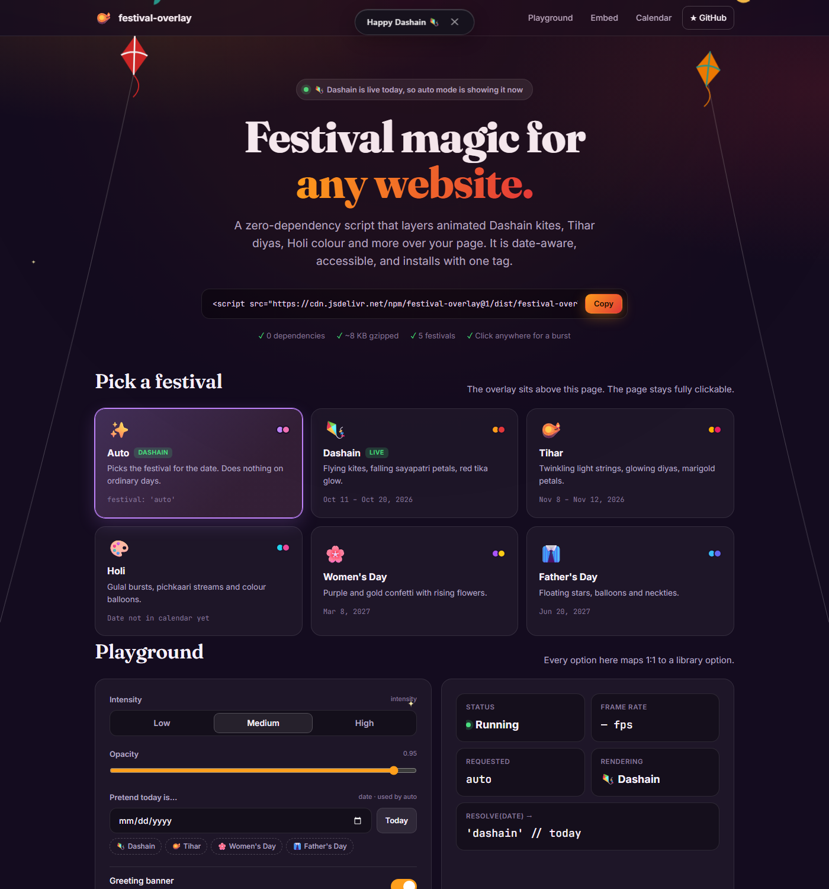
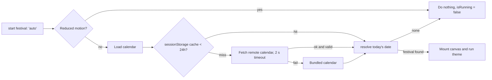

<div align="center">

# 🪔 festival-overlay

**Animated festival decorations for any website, with one script tag.**

Dashain kites, Tihar diyas, Holi colour, Women's Day confetti and Father's Day stars.
Drawn with pure Canvas 2D, zero dependencies, and date-aware so the right festival appears on the right day.

[](https://www.npmjs.com/package/festival-overlay)
[](https://www.jsdelivr.com/package/npm/festival-overlay)
[](https://github.com/PuspaRaj-Subedi/festival-overlay/actions/workflows/ci.yml)
[](LICENSE)
[](#-size-budget)
[](package.json)

### [▶ Live demo](https://pusparaj-subedi.github.io/festival-overlay/) · [Embed](#-quick-start) · [API](#-api) · [Recipes](#-platform-recipes) · [Custom themes](#-writing-a-theme)

<a href="https://pusparaj-subedi.github.io/festival-overlay/"></a>

</div>

---

## ✨ Features

| | |
|---|---|
| 🎆 **Five built-in festivals** | `dashain`, `tihar`, `holi`, `womens-day`, `fathers-day` |
| 📅 **Date-aware `auto` mode** | Shows the festival that is active today and does nothing on other days |
| 🌐 **CDN first** | One `<script>` tag with `data-*` options. No build step. |
| 🔄 **Remote calendar** | Festival dates update over the CDN without anyone upgrading the package |
| 🪶 **Zero dependencies** | No images, fonts or frameworks. About 8 KB gzipped for everything. |
| 🖱️ **Never in the way** | `pointer-events: none`, `aria-hidden`, optional auto-stop |
| ♿ **Accessible** | Respects `prefers-reduced-motion` and pauses while the tab is hidden |
| ⚡ **Fast** | Pooled particles with no per-frame allocations, time-based motion, DPR capped at 2 |
| 🧩 **Pluggable** | A new festival is one theme file plus one calendar entry |
| 🖥️ **SSR safe** | Importing never touches `window`, and `start()` does nothing on the server |

### Festivals

| id | Festival | What you see | When `auto` shows it |
|---|---|---|---|
| `dashain` | Dashain 🇳🇵 | Flying kites (changa), falling sayapatri petals, red tika glow | Calendar range (lunar) |
| `tihar` | Tihar 🇳🇵 | Twinkling light strings, glowing diyas, tumbling sayapatri (marigold) flowers | Calendar range (lunar) |
| `holi` | Holi | Gulal powder bursts, pichkaari streams, colour balloons | Calendar range (lunar) |
| `womens-day` | International Women's Day | Purple and gold confetti, rising flowers | 8 March |
| `fathers-day` | Father's Day | Floating stars, balloons, neckties | 3rd Sunday of June |

---

## 🚀 Quick start

> **Try it first:** open the [live demo](https://pusparaj-subedi.github.io/festival-overlay/). It loads the same UMD bundle the CDN serves.

### 1. One tag, fully automatic

Paste this before `</body>`. On a festival day it decorates the page for 30 seconds. On other days it does nothing.

```html
<script src="https://cdn.jsdelivr.net/npm/festival-overlay@1/dist/festival-overlay.auto.min.js"
        data-festival="auto"
        data-intensity="medium"
        data-duration="30000"
        data-banner="true"></script>
```

### 2. Explicit control

```html
<script src="https://cdn.jsdelivr.net/npm/festival-overlay@1/dist/festival-overlay.umd.min.js"></script>
<script>
  FestivalOverlay.start({ festival: 'tihar', intensity: 'low', banner: true });
</script>
```

### 3. ESM, one theme only (smallest payload)

```html
<script type="module">
  import FestivalOverlay from 'https://cdn.jsdelivr.net/npm/festival-overlay@1/dist/festival-overlay.esm.min.js';
  import tihar from 'https://cdn.jsdelivr.net/npm/festival-overlay@1/dist/themes/tihar.esm.js';

  FestivalOverlay.register(tihar);
  FestivalOverlay.start({ festival: 'tihar' });
</script>
```

### 4. Pin a version with SRI (recommended for production)

```html
<script src="https://cdn.jsdelivr.net/npm/festival-overlay@1.0.0/dist/festival-overlay.umd.min.js"
        integrity="sha384-+4vFiPty/GKOnMXYXAJswpjigc7DMPrxQnqf52srWInAWhNonnhqB6tLjZvMTByf"
        crossorigin="anonymous"></script>
```

| File (`@1.0.0`) | `integrity` |
|---|---|
| `festival-overlay.umd.min.js` | `sha384-+4vFiPty/GKOnMXYXAJswpjigc7DMPrxQnqf52srWInAWhNonnhqB6tLjZvMTByf` |
| `festival-overlay.auto.min.js` | `sha384-X8gOikT/SnHx3LoJiVYNooUeJrDX2IPBvfGNzeUx+j4Ec8QbZxTsac5GpkVly50G` |
| `festival-overlay.esm.min.js` | `sha384-xy20r8OI/wbl4/ilBBX9WjbjIvwQxUKM7n25YyHEBo5FfZeBwYf8SLPWCMx8N2qh` |

These hashes belong to version 1.0.0 only. For other versions, `npm run build` prints the hash of every file, or you can use [jsDelivr](https://www.jsdelivr.com/package/npm/festival-overlay) (open the file, then "Copy HTML + SRI"). Use a hash only with an exact version like `@1.0.0`, never with a range like `@1`, because the file behind a range changes when a new version is released.

### 5. npm

```bash
npm install festival-overlay
```

```js
import FestivalOverlay from 'festival-overlay';

FestivalOverlay.start({ festival: 'auto', banner: true });
```

---

## 📖 API

```js
FestivalOverlay.start({ festival: 'auto' });   // singleton; returns Promise<Controller>
FestivalOverlay.stop();                        // idempotent; removes canvas, banner, listeners, timers
FestivalOverlay.toggle(options?);
FestivalOverlay.isRunning();                   // boolean

const c = FestivalOverlay.create(options);     // independent instance with its own canvas
await c.start(); c.stop(); c.toggle(); c.isRunning();
await c.setFestival('tihar');                  // hot-swap the theme without remounting

FestivalOverlay.register(themeObject);         // add a custom theme
FestivalOverlay.themes;                        // ['tihar', 'dashain', 'womens-day', 'fathers-day', 'holi']
FestivalOverlay.resolve('2026-10-15');         // what would "auto" pick? → 'dashain' | null
FestivalOverlay.version;                       // '1.0.0'
```

If `festival: 'auto'` finds nothing active, `start()` resolves with a controller whose `isRunning()` is `false`. **It never throws.**

### Options

| Option | Type | Default | Notes |
|---|---|---|---|
| `festival` | `string` | `'auto'` | A theme id, or `'auto'` to pick by date |
| `intensity` | `'low' \| 'medium' \| 'high'` | `'medium'` | Scales the particle caps. Caps drop further on screens narrower than 768 px. |
| `zIndex` | `number` | `99999` | |
| `opacity` | `number` | `0.95` | 0 to 1 |
| `duration` | `number` | `0` | Auto-stop after N ms. `0` runs until `stop()`. |
| `container` | `string \| HTMLElement` | `'body'` | CSS selector or element |
| `banner` | `boolean \| string` | `false` | Greeting ribbon in Shadow DOM. A string replaces the text. |
| `colors` | `Array<{r,g,b}>` | theme palette | Override the palette |
| `date` | `Date \| string` | today | Pretend today is this date (for testing `auto`) |
| `calendarUrl` | `string \| false` | jsDelivr URL | Remote calendar. `false` disables the fetch. |
| `respectReducedMotion` | `boolean` | `true` | Don't animate when the OS asks for reduced motion |
| `onStart`, `onStop` | `function` | none | Lifecycle hooks |

### `data-*` attributes (auto script)

`festival-overlay.auto.min.js` reads these from its own `<script>` tag:

| Attribute | Maps to | Example |
|---|---|---|
| `data-festival` | `festival` | `auto`, `tihar` |
| `data-intensity` | `intensity` | `low` |
| `data-duration` | `duration` | `30000` |
| `data-opacity` | `opacity` | `0.8` |
| `data-z-index` | `zIndex` | `2147483000` |
| `data-container` | `container` | `#hero` |
| `data-banner` | `banner` | `true`, `false`, or custom text |
| `data-calendar-url` | `calendarUrl` | a URL, or `off` |
| `data-date` | `date` | `2026-11-09` (testing) |
| `data-autostart` | | `false` loads the script without starting it |

---

## 📅 How `auto` mode works



The order of precedence is:

1. A `date` override, if you passed one.
2. The remote calendar.
3. The calendar bundled at build time.

Fixed and rule-based festivals (8 March, 3rd Sunday of June) are computed. **Dashain, Tihar and Holi follow the lunar Bikram Sambat calendar, so they are stored as data and never computed.** All date math uses the visitor's local date.

The remote calendar lives at [`calendar/festivals.json`](calendar/festivals.json) and is served from:

```
https://cdn.jsdelivr.net/gh/PuspaRaj-Subedi/festival-overlay@main/calendar/festivals.json
```

Editing that file updates every site that uses `auto` without a package upgrade. jsDelivr caches `@main` for a while, and you can [purge it](https://www.jsdelivr.com/tools/purge) after an edit. For privacy-sensitive sites, set `calendarUrl: false` or `data-calendar-url="off"` to stop all network calls.

### Current calendar

| Festival | 2026 | Status |
|---|---|---|
| Dashain | 11 – 20 Oct | ⚠️ unverified |
| Tihar | 8 – 12 Nov | ⚠️ unverified |
| Holi | 3 – 4 Mar | ⚠️ unverified |
| Women's Day | 8 Mar | rule |
| Father's Day | 21 Jun | rule (3rd Sunday of June) |

> Lunar ranges keep `"verified": false` until a maintainer checks them against the official Nepal government holiday list or Hamro Patro. **2027 ranges are not added yet.** PRs with sourced dates are very welcome.

---

## 🧰 Platform recipes

<details>
<summary><b>WordPress</b></summary>

`functions.php`:

```php
add_action('wp_enqueue_scripts', function () {
    wp_enqueue_script(
        'festival-overlay',
        'https://cdn.jsdelivr.net/npm/festival-overlay@1/dist/festival-overlay.auto.min.js',
        array(), null, true
    );
});
add_filter('script_loader_tag', function ($tag, $handle) {
    if ($handle !== 'festival-overlay') return $tag;
    return str_replace(' src=', ' data-festival="auto" data-banner="true" data-duration="30000" src=', $tag);
}, 10, 2);
```

You can also skip code: use a footer-scripts plugin (for example *WPCode*) and paste the [one-tag snippet](#1-one-tag-fully-automatic).
</details>

<details>
<summary><b>Shopify</b></summary>

**Online Store → Themes → Edit code → `layout/theme.liquid`**, just before `</body>`:

```html
<script src="https://cdn.jsdelivr.net/npm/festival-overlay@1/dist/festival-overlay.auto.min.js"
        data-festival="auto" data-banner="true" data-duration="30000" defer></script>
```
</details>

<details>
<summary><b>Wix · Squarespace</b></summary>

- **Wix:** Settings → Custom Code → Add Custom Code. Paste the one-tag snippet, place it in *Body – end*, and apply it to *All pages*.
- **Squarespace:** Settings → Advanced → Code Injection → **Footer**. Paste the one-tag snippet.
</details>

<details>
<summary><b>Google Tag Manager</b></summary>

Create a **Custom HTML** tag that fires on *All Pages*:

```html
<script src="https://cdn.jsdelivr.net/npm/festival-overlay@1/dist/festival-overlay.auto.min.js"
        data-festival="auto" data-intensity="medium" data-duration="30000"></script>
```

GTM injects tags dynamically. The auto script falls back to finding its `<script data-festival>` tag, so the attributes still work. If you prefer explicit code, use this:

```html
<script src="https://cdn.jsdelivr.net/npm/festival-overlay@1/dist/festival-overlay.umd.min.js"></script>
<script>FestivalOverlay.start({ festival: 'auto', duration: 30000 });</script>
```
</details>

<details>
<summary><b>React</b></summary>

```jsx
import { useEffect } from 'react';
import FestivalOverlay from 'festival-overlay';

export function Festive({ festival = 'auto' }) {
  useEffect(() => {
    const c = FestivalOverlay.create({ festival, banner: true });
    c.start();
    return () => c.stop();
  }, [festival]);
  return null;
}
```
</details>

<details>
<summary><b>Next.js (App Router)</b></summary>

```jsx
// app/festive.jsx
'use client';
import { useEffect } from 'react';
import FestivalOverlay from 'festival-overlay';

export default function Festive() {
  useEffect(() => {
    const c = FestivalOverlay.create({ festival: 'auto', banner: true });
    c.start();
    return () => c.stop();
  }, []);
  return null;
}

// app/layout.jsx → render <Festive /> inside <body>
```
</details>

<details>
<summary><b>Next.js (Pages Router)</b></summary>

```jsx
// pages/_app.jsx
import { useEffect } from 'react';
import FestivalOverlay from 'festival-overlay';

export default function App({ Component, pageProps }) {
  useEffect(() => {
    FestivalOverlay.start({ festival: 'auto' });
    return () => FestivalOverlay.stop();
  }, []);
  return <Component {...pageProps} />;
}
```
</details>

<details>
<summary><b>Vue 3</b></summary>

```vue
<script setup>
import { onMounted, onBeforeUnmount } from 'vue';
import FestivalOverlay from 'festival-overlay';

onMounted(() => FestivalOverlay.start({ festival: 'auto', banner: true }));
onBeforeUnmount(() => FestivalOverlay.stop());
</script>
```
</details>

<details>
<summary><b>Svelte</b></summary>

```svelte
<script>
  import { onMount } from 'svelte';
  import FestivalOverlay from 'festival-overlay';

  onMount(() => {
    FestivalOverlay.start({ festival: 'auto' });
    return () => FestivalOverlay.stop();
  });
</script>
```
</details>

<details>
<summary><b>Angular</b></summary>

```ts
import { Component, OnDestroy, OnInit } from '@angular/core';
import FestivalOverlay from 'festival-overlay';

@Component({ selector: 'app-root', templateUrl: './app.component.html' })
export class AppComponent implements OnInit, OnDestroy {
  ngOnInit() { FestivalOverlay.start({ festival: 'auto' }); }
  ngOnDestroy() { FestivalOverlay.stop(); }
}
```
</details>

---

## 🎨 Writing a theme

A theme is a plain object. The engine owns the canvas, the loop and the particle pool. The theme only describes the visuals.

```js
FestivalOverlay.register({
  id: 'sparkle',
  name: 'Sparkle',
  greeting: 'Happy Celebration ✨',
  palette: [{ r: 255, g: 215, b: 0 }],
  caps: { low: 20, medium: 50, high: 100 },        // max live particles

  spawn(state) {
    return { x: Math.random() * state.width, y: state.height + 10,
             vx: (Math.random() - 0.5) * 20, vy: -40 - Math.random() * 40,
             size: 2 + Math.random() * 4, life: 1 };
  },
  update(p, dt) {                                   // dt in seconds
    p.x += p.vx * dt;
    p.y += p.vy * dt;
    p.life -= dt / 5;
    return p.life > 0;                              // false recycles the particle
  },
  draw(ctx, p, state) {
    const c = state.palette[0];                     // keeps `colors` overrides working
    ctx.fillStyle = `rgba(${c.r},${c.g},${c.b},${p.life})`;
    ctx.beginPath();
    ctx.arc(p.x, p.y, p.size, 0, Math.PI * 2);
    ctx.fill();
  },
  // optional: init(ctx, state), drawBackground(ctx, state), drawForeground(ctx, state)
});

FestivalOverlay.start({ festival: 'sparkle' });
```

The rules are:

- Use time-based motion (`dt`).
- Don't allocate in `update` or `draw`.
- Take colours from `state.palette`.
- Never touch the DOM.

To add a built-in festival, add `src/themes/<id>.js` and an entry in `calendar/festivals.json`. The engine needs no changes.

---

## 📦 Build outputs

| File | Format | Use |
|---|---|---|
| `dist/festival-overlay.umd.min.js` | UMD | Default CDN `<script>`, exposes `window.FestivalOverlay` |
| `dist/festival-overlay.auto.min.js` | IIFE | One-tag auto-init |
| `dist/festival-overlay.esm(.min).js` | ESM | Bundlers and `<script type="module">` |
| `dist/festival-overlay.cjs` | CJS | Node `require` |
| `dist/themes/<id>.esm.js` | ESM | One theme on its own |
| `dist/festival-overlay.d.ts` | Types | TypeScript |
| `dist/festivals.json` | JSON | Calendar copy |

### 📏 Size budget

CI fails if any budget is exceeded.

| Bundle | gzipped | Budget |
|---|---|---|
| Full bundle with all 5 themes (`umd.min.js`) | **8.6 KB** | 35 KB |
| Auto bundle (`auto.min.js`) | **8.6 KB** | 35 KB |
| One theme (`themes/*.esm.js`) | **1.0 – 1.9 KB** | 6 KB |

---

## 🛠️ Development

```bash
git clone https://github.com/PuspaRaj-Subedi/festival-overlay.git
cd festival-overlay
npm install          # the only dev dependency is esbuild
npm run build        # writes dist/ and prints sizes and SRI hashes
npm test             # node:test unit tests (rules, resolve, options, engine)
npm run demo         # http://localhost:8080/demo.html
```

```
src/
├─ index.js            public API (singleton + create)
├─ auto.js             script-tag auto-init (reads data-*)
├─ core/               engine (canvas, RAF loop, resize, visibility), particles, options
├─ schedule/           rules, resolve(), calendar loading and caching
├─ themes/             one file per festival plus the registry
└─ ui/banner.js        Shadow DOM greeting ribbon
calendar/festivals.json  the date table served by the CDN
```

`dist/` is committed on purpose, so that the jsDelivr GitHub URLs and the demo page always have files to serve.

### Releasing

1. Bump `version` in `package.json` and `src/index.js`.
2. Run `npm run build && npm test`.
3. Commit, then `git tag v1.x.y && git push --tags`.

The **Release** workflow publishes to npm. It needs an `NPM_TOKEN` repository secret. Changes to the calendar alone are patch releases.

## 🤝 Contributing

Issues and PRs are welcome, especially:

- **Verified festival dates** for Dashain, Tihar and Holi in 2027 and later. Please cite a source.
- **New festival themes**, for example Chhath, Losar, Eid, Diwali or Christmas.

Commits follow [Conventional Commits](https://www.conventionalcommits.org/). See [AGENTS.md](AGENTS.md) for the full design spec.

## 📄 License

[MIT](LICENSE). Inspired by [holi-overlay](https://github.com/DevCodeHub99/holi-overlay).
